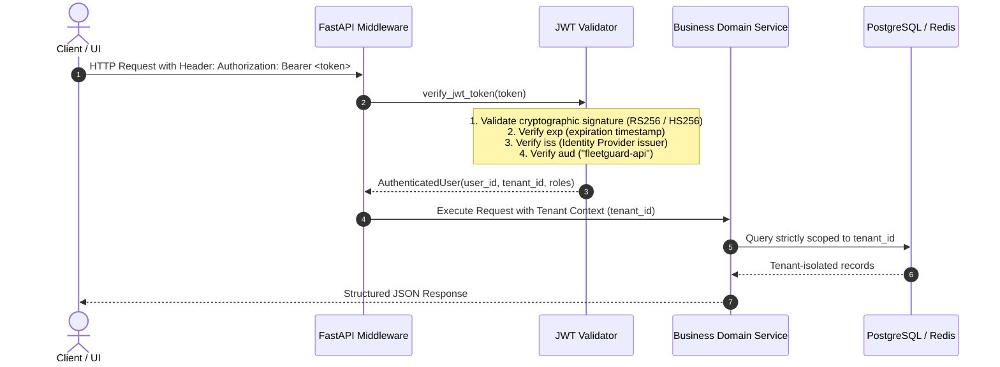

# FleetGuard Pulse — Enterprise API Architecture & Specification

**Service Name:** `services/api/`  
**API Version:** `1.0.0`  
**Protocol:** REST (HTTP/1.1 & HTTP/2) + WebSocket (WSS)  
**Authentication Standard:** Keycloak-compatible OIDC / OAuth2 Bearer JWT  
**OpenAPI Specification:** Served dynamically at `/openapi.json`, UI docs at `/docs` and `/redoc`  

---

## 1. Architectural Principles & Isolation Boundaries

The FleetGuard Pulse API is designed with defense-in-depth security, strict multi-tenant data isolation, and high performance:

1. **Stateless Scalability:** API workers maintain zero session affinity; all request state is resolved via signed JWT claims and Redis rate-limiting keys.
2. **Authoritative vs Transient State Separation:**
   - Authoritative relational entities (tenants, fleets, depots, vehicle specifications, maintenance records, durable alerts, work orders) are strictly governed by **PostgreSQL 16 in 3NF**.
   - Transient high-velocity operating telemetry (current GPS, live odometer, speed, sequence number, instantaneous health status) is served from **Redis 7 hot state**.
   - Responses cleanly isolate authoritative metadata from ephemeral telemetry.
3. **Multi-Tenant Boundary:** Every authenticated request extracts `tenant_id` directly from cryptographically validated token claims. All SQL queries and Redis lookups are scoped by `WHERE tenant_id = %s`. Cross-tenant queries return `404 Not Found` (or `403 Forbidden`) to prevent enumeration attacks.
4. **Defensive Headers & Auditability:** Every response includes unique `X-Request-ID` correlation identifiers, strict CSP, nosniff, frame protection, and Prometheus latency tracking.

---

## 2. Authentication & RBAC Model

### 2.1 JWT Verification Flow


### 2.2 Locked Role-Based Access Control (RBAC)
FleetGuard Pulse enforces three locked operational roles:

| Role | Operational Scope | Permitted Endpoints |
| :--- | :--- | :--- |
| **`ADMIN`** | System & Fleet Administration | Full access to all endpoints, configuration, work-order assignment, audit logs, and analytics. |
| **`DISPATCHER`** | Operational Fleet Monitoring & Routing | Vehicle directory, vehicle health, fleet health, predictive risk scoring, active alerts, work-order creation, analytics. |
| **`TECHNICIAN`** | Diagnostic Triage & Depot Maintenance | Vehicle details, health status, predictive risk, pgvector diagnostic similarity matching, work orders. |

### 2.3 Endpoint Role Mapping

| Endpoint | Method | Permitted Roles | Authentication Required |
| :--- | :---: | :--- | :---: |
| `/health` | `GET` | Anonymous / Public | No |
| `/ready` | `GET` | Anonymous / Public | No |
| `/metrics` | `GET` | Prometheus Scraper / Admin | No |
| `/vehicles` | `GET` | `ADMIN`, `DISPATCHER`, `TECHNICIAN` | Yes (Bearer JWT) |
| `/vehicles/{vin}` | `GET` | `ADMIN`, `DISPATCHER`, `TECHNICIAN` | Yes (Bearer JWT) |
| `/vehicles/{vin}/health` | `GET` | `ADMIN`, `DISPATCHER`, `TECHNICIAN` | Yes (Bearer JWT) |
| `/vehicles/{vin}/risk` | `GET` | `ADMIN`, `DISPATCHER`, `TECHNICIAN` | Yes (Bearer JWT) |
| `/alerts` | `GET` | `ADMIN`, `DISPATCHER`, `TECHNICIAN` | Yes (Bearer JWT) |
| `/alerts/{alert_id}` | `GET` | `ADMIN`, `DISPATCHER`, `TECHNICIAN` | Yes (Bearer JWT) |
| `/fleets` | `GET` | `ADMIN`, `DISPATCHER`, `TECHNICIAN` | Yes (Bearer JWT) |
| `/fleets/{fleet_id}/health`| `GET` | `ADMIN`, `DISPATCHER`, `TECHNICIAN` | Yes (Bearer JWT) |
| `/diagnostics/similar` | `GET` | `TECHNICIAN`, `ADMIN` | Yes (Bearer JWT) |
| `/maintenance/work-orders`| `POST`| `ADMIN`, `DISPATCHER`, `TECHNICIAN` | Yes (Bearer JWT) |
| `/analytics/summary` | `GET` | `ADMIN`, `DISPATCHER` | Yes (Bearer JWT) |
| `/ws/alerts` | `WS` | All authenticated tenant users | Yes (Token param) |

---

## 3. Rate Limiting Architecture

- **State Store:** Redis 7 (utilizes existing cluster datastore; zero new database dependencies introduced).
- **Algorithm:** Atomic sliding-window minute counter (`rate_limit:{tenant_id|ip}:{minute}`).
- **Default Limit:** Configurable via `RATE_LIMIT_REQUESTS_PER_MINUTE` (default: **120 requests/minute** per tenant).
- **Response Headers:**
  - `X-RateLimit-Limit`: Maximum requests permitted in window (e.g. 120)
  - `X-RateLimit-Remaining`: Remaining request quota in current window
  - `X-RateLimit-Reset`: Seconds remaining until quota reset
- **Error Behavior:** Exceeding threshold triggers **`HTTP 429 Too Many Requests`** with a standard `Retry-After: <seconds>` response header and structured error payload.

---

## 4. Defensive Security Headers

Applied globally via `SecurityHeadersMiddleware`:

```http
X-Request-ID: <uuidv4>
X-Content-Type-Options: nosniff
X-Frame-Options: DENY
X-XSS-Protection: 1; mode=block
Referrer-Policy: strict-origin-when-cross-origin
Content-Security-Policy: default-src 'self'; img-src 'self' data:; style-src 'self' 'unsafe-inline'; script-src 'self';
```
*(In production HTTPS environments, `Strict-Transport-Security: max-age=31536000; includeSubDomains; preload` is automatically enabled).*

---

## 5. Structured Error Model

The API never returns unformatted error strings, raw stack traces, SQL syntax, or internal credentials. All errors conform to the canonical error schema:

```json
{
  "error": {
    "code": "RESOURCE_NOT_FOUND",
    "message": "Vehicle with identifier '1CHK1234567890123' was not found within tenant domain",
    "details": {
      "resource": "Vehicle",
      "identifier": "1CHK1234567890123"
    }
  },
  "request_id": "8d3e9114-1e0f-4889-b1d6-857cbf81fae4"
}
```

Standard error codes:
- `UNAUTHORIZED`: Missing, malformed, or expired token.
- `FORBIDDEN_INSUFFICIENT_ROLE`: User lacks required RBAC role.
- `FORBIDDEN_TENANT_ISOLATION`: Access to resource owned by another tenant rejected.
- `RESOURCE_NOT_FOUND`: Entity not found within requesting tenant's scope.
- `INVALID_INPUT` / `VALIDATION_ERROR`: Malformed input parameters.
- `RATE_LIMIT_EXCEEDED`: Request frequency quota exceeded (HTTP 429).
- `SERVICE_UNAVAILABLE`: Datastore connection degradation (HTTP 503).
- `INTERNAL_SERVER_ERROR`: Sanitized generic unhandled exception (HTTP 500).

---

## 6. Endpoints Reference & Request/Response Contracts

### 6.1 `GET /vehicles`
- **Description:** Returns paginated vehicle directory scoped to tenant.
- **Parameters:** `fleet_id` (UUID), `vehicle_type` (`ICE`, `HEV`, `BEV`), `status` (`ACTIVE`, `MAINTENANCE`), `page` (int), `limit` (int).
- **Example Response:**
```json
{
  "items": [
    {
      "vehicle_id": "e0000000-0000-0000-0000-000000000001",
      "vin": "1FDXE4FN8PK123456",
      "license_plate": "IL-TRK-101",
      "status": "ACTIVE",
      "manufacture_year": 2023,
      "fleet_id": "d0000000-0000-0000-0000-000000000001",
      "fleet_name": "Express Regional Delivery",
      "fleet_code": "FLEET-EXPRESS",
      "depot_id": "c0000000-0000-0000-0000-000000000001",
      "depot_name": "Central Operations Hub",
      "depot_code": "DEPOT-CENTRAL",
      "model": {
        "make": "Freightliner",
        "model_name": "Cascadia Heavy",
        "year": 2023,
        "vehicle_type": "ICE",
        "engine_displacement_l": 12.8,
        "battery_capacity_kwh": null,
        "curb_weight_kg": 8200
      }
    }
  ],
  "pagination": {
    "page": 1,
    "limit": 50,
    "total_count": 10007,
    "total_pages": 201
  }
}
```

### 6.2 `GET /vehicles/{vin}`
- **Description:** Returns authoritative relational record combined with live transient telemetry hot state from Redis.
- **Example Response:**
```json
{
  "vin": "1FDXE4FN8PK123456",
  "authoritative": {
    "vehicle_id": "e0000000-0000-0000-0000-000000000001",
    "vin": "1FDXE4FN8PK123456",
    "tenant_id": "a0000000-0000-0000-0000-000000000001",
    "license_plate": "IL-TRK-101",
    "manufacture_year": 2023,
    "status": "ACTIVE",
    "initial_odometer_km": 15000.0,
    "created_at": "2026-10-01T08:00:00Z",
    "updated_at": "2026-10-01T08:00:00Z",
    "fleet": { "fleet_id": "d0000000-...", "name": "Express Regional Delivery", "code": "FLEET-EXPRESS" },
    "depot": { "depot_id": "c0000000-...", "name": "Central Operations Hub", "code": "DEPOT-CENTRAL" },
    "model": { "make": "Freightliner", "model_name": "Cascadia Heavy", "year": 2023, "vehicle_type": "ICE" }
  },
  "transient_state": {
    "sequence_number": 8421,
    "timestamp": "2026-10-01T12:00:00Z",
    "health_status": "NOMINAL",
    "latitude": 41.8781,
    "longitude": -87.6298,
    "speed_kmh": 68.4,
    "odometer_km": 15420.5,
    "vibration": 0.34,
    "dtc_codes": [],
    "coolant_temp_c": 88.5,
    "oil_pressure_kpa": 310.0,
    "engine_rpm": 1850.0,
    "updated_at": "2026-10-01T12:00:01Z"
  }
}
```

### 6.3 `GET /vehicles/{vin}/risk`
- **Description:** Real-time 7-day predictive maintenance risk score powered by the verified Logistic Regression Pipeline.
- **Example Response:**
```json
{
  "vin": "1FDXE4FN8PK123456",
  "probability_7d": 0.2175,
  "predicted_maintenance_required": false,
  "risk_level": "LOW",
  "decision_threshold": 0.90,
  "top_risk_factors": [
    {
      "feature_name": "vibration_mean",
      "feature_value": 0.35,
      "standardized_value": 0.4215,
      "coefficient": 1.1750,
      "contribution": 0.4953,
      "direction": "INCREASES_RISK"
    }
  ],
  "protective_factors": [
    {
      "feature_name": "km_since_last_maintenance",
      "feature_value": 420.0,
      "standardized_value": -0.8412,
      "coefficient": -0.9654,
      "contribution": 0.8121,
      "direction": "REDUCES_RISK"
    }
  ],
  "model_version": "1.1.0",
  "prediction_timestamp": "2026-10-01T12:15:30.123456Z",
  "disclaimer": "Statistical risk estimate represents estimated probability of unscheduled maintenance or mechanical failure within the next 7 days based on longitudinal CAN-bus degradation. This is an advisory risk score, not a deterministic guarantee of component failure."
}
```

### 6.4 `GET /diagnostics/similar`
- **Description:** PostgreSQL pgvector HNSW cosine distance nearest-neighbor query over 16-D failure signatures.
- **Parameters:** `vector` (comma-separated 16 floats), `vehicle_type` (`ICE`, `HEV`, `BEV`, optional), `limit` (int, default 5).
- **Example Response:**
```json
{
  "query_vector_dimension": 16,
  "matches": [
    {
      "signature_id": "00000000-0000-0000-0000-000000000001",
      "fault_type": "ENGINE_OVERHEAT",
      "vehicle_type": "ICE",
      "description": "High coolant temperature, elevated vibration shock, and severe oil pressure drop indicating impending coolant circuit failure",
      "cosine_distance": 0.0000,
      "similarity_score": 1.0000,
      "feature_schema_version": "1.0"
    }
  ],
  "methodology": "PostgreSQL pgvector cosine distance nearest-neighbor search over historical diagnostic fault signatures. Demonstrates embedding similarity search, not predictive ML."
}
```

### 6.5 `GET /fleets/{fleet_id}/health`
- **Description:** Consolidated fleet operational health metrics computed in two aggregate SQL queries (zero N+1 queries).
- **Example Response:**
```json
{
  "fleet_id": "d0000000-0000-0000-0000-000000000001",
  "fleet_name": "Express Regional Delivery",
  "fleet_code": "FLEET-EXPRESS",
  "total_vehicles": 5003,
  "vehicles_by_status": { "ACTIVE": 4850, "MAINTENANCE": 120, "INACTIVE": 33, "DECOMMISSIONED": 0 },
  "vehicles_by_type": { "ICE": 3200, "HEV": 1300, "BEV": 503 },
  "health_status_counts": { "NOMINAL": 4750, "WARNING": 200, "CRITICAL": 53 },
  "critical_alert_count": 53,
  "high_risk_vehicle_count": 253,
  "work_orders_summary": { "PENDING": 45, "SCHEDULED": 22, "IN_PROGRESS": 18, "COMPLETED": 412 }
}
```

### 6.6 `POST /maintenance/work-orders`
- **Description:** Creates a normalized 3NF work order. Validates vehicle existence, maintenance type catalog, and tenant ownership.
- **Request Payload:**
```json
{
  "vin": "1FDXE4FN8PK123456",
  "type_id": 1,
  "priority": "HIGH",
  "scheduled_at": "2026-10-02T09:00:00Z",
  "assigned_technician_id": "b0000000-0000-0000-0000-000000000003"
}
```
- **Response (HTTP 201 Created):**
```json
{
  "work_order_id": "993a4bc0-716b-4e1a-8217-10901eec9562",
  "tenant_id": "a0000000-0000-0000-0000-000000000001",
  "vehicle_id": "e0000000-0000-0000-0000-000000000001",
  "vin": "1FDXE4FN8PK123456",
  "type_id": 1,
  "maintenance_type_name": "A-Service PM Inspection",
  "priority": "HIGH",
  "status": "PENDING",
  "assigned_technician_id": "b0000000-0000-0000-0000-000000000003",
  "scheduled_at": "2026-10-02T09:00:00Z",
  "created_at": "2026-10-01T12:20:00Z",
  "updated_at": "2026-10-01T12:20:00Z"
}
```

### 6.7 `WS /ws/alerts`
- **Description:** Real-time push stream for critical alerts to live dashboard clients.
- **Protocol:** WebSocket (ws:// or wss://). Authenticates via query parameter token (`?token=<jwt>`).
- **Heartbeat:** Supports client `{"type": "PING"}` frames, returns `{"type": "PONG"}`.

---

## 7. Observability & Telemetry

Exposed at `GET /metrics` in standard Prometheus exposition format:
- `fleetguard_http_requests_total{method, endpoint, status}`: Request counter.
- `fleetguard_http_request_duration_seconds`: Request latency histogram with 10 standard latency buckets.
- `fleetguard_active_ws_connections`: Live gauge of active WebSocket clients.
- `fleetguard_ml_predictions_total{version}`: Prediction invocation counter.
- `fleetguard_ml_prediction_duration_seconds`: Model inference latency summary.
- `fleetguard_db_errors_total{store}`: Datastore error tracking.
- `fleetguard_rate_limit_exceeded_total`: Throttled request count.

---

## 8. Phase 8.1 API Evidence, Verification & Contract Testing Audit

### 8.1 WebSocket Real Alert Delivery Evidence & Deduplication
To verify real-time alert forwarding from the ingest/alert pipeline to connected frontend dashboards:
- **Dispatcher Service:** Implemented in `services/api/services/alert_dispatcher.py` (`AlertDispatcher`).
- **Connection Management:** Maintains thread-safe/async registry of active WebSockets scoped by `tenant_id`.
- **Deduplication / Idempotency:** Implements Redis atomic `SETNX` on key `alert:dispatched:{alert_id}` with a 120-second TTL (falling back to local in-memory LRU cache if Redis is unavailable). Guarantees that at-least-once message reprocessing does not flood connected browser clients with duplicate toast/banner frames.
- **Payload Integrity:** Preserves original `alert_id`, `vin`, `severity`, `fault_type`, `message`, `sequence_number`, and `telemetry_event_id`.
- **Integration Test:** `tests/integration/test_api_integration.py::test_websocket_functional_alert_delivery` connects a test WebSocket client, dispatches a critical alert, verifies receipt of matching fields, and proves that a subsequent duplicate dispatch is safely suppressed.

### 8.2 OpenAPI 3.1 Runtime Contract Test Suite
Dedicated contract test suite implemented in `tests/contract/test_api_contracts.py` (7 tests):
- Extracts canonical JSON schemas dynamically from `app.openapi()["components"]["schemas"]`.
- Validates runtime API responses using `jsonschema.validate` (Draft 2020-12 / Draft 7) across core endpoints:
  - `GET /vehicles` -> `VehicleListResponse`
  - `GET /vehicles/{vin}/risk` -> `VehicleRiskResponse`
  - `GET /alerts` -> `AlertListResponse`
  - `GET /diagnostics/similar` -> `DiagnosticSimilarityResponse`
  - `POST /maintenance/work-orders` -> `WorkOrderResponse`
- Verifies contract error rejection:
  - `POST /maintenance/work-orders` with invalid priority returns `HTTP 422 Unprocessable Content` conforming to standard `HTTPValidationError`.

### 8.3 Authentication Configuration Audit & Production Fail-Safe
- **Development Mode (`AUTH_DEV_MODE=True`):** Allows local HMAC-SHA256 tokens for development and testing simplicity.
- **Production Mode (`AUTH_DEV_MODE=False`):** Enforces asymmetric RS256 with Keycloak/OIDC `JWT_PUBLIC_KEY` or non-default cryptographically secure symmetric secret.
- **Safe Failure Guarantee:** If `AUTH_DEV_MODE` is disabled and production keys are missing or set to the default dev placeholder, `verify_jwt_token` raises `AuthenticationError` (HTTP 401 Unauthorized) rather than silently allowing insecure fallback. Verified in `tests/integration/test_api_security.py::test_production_auth_fails_safely_on_misconfiguration`.

### 8.4 Security Headers, TLS Termination & HSTS Scope
- **Defense-in-Depth Middleware:** `services/api/security.py` applies security headers across all HTTP responses:
  - `X-Content-Type-Options: nosniff`
  - `X-Frame-Options: DENY`
  - `X-XSS-Protection: 1; mode=block`
  - `Referrer-Policy: strict-origin-when-cross-origin`
  - `Content-Security-Policy: default-src 'self'; script-src 'self' 'unsafe-inline'; ...`
  - `Permissions-Policy: geolocation=(), camera=(), microphone=()`
  - `Cache-Control: no-store, no-cache, must-revalidate` (on sensitive authenticated endpoints)
- **HSTS & TLS Architecture Scope:**
  - *Local Development:* Executed over plain HTTP (`http://localhost:8000`). HTTP Strict Transport Security (`Strict-Transport-Security`) is deliberately **not** emitted over plain HTTP to prevent local browser certificate locking.
  - *Production Deployment:* TLS termination (HTTPS / WSS) is executed upstream by the Kubernetes Ingress Controller / Reverse Proxy (e.g. AWS ALB, Traefik, NGINX Ingress). Upstream ingress terminates TLS certificates and injects `Strict-Transport-Security: max-age=31536000; includeSubDomains`.

### 8.5 Local Sequential API Latency Benchmark
Measured via `scripts/benchmark_api.py` on macOS (Apple Silicon M-series, Python 3.11, Docker PostgreSQL 16 & Redis 7):

| Endpoint | Method | Requests | Mean (ms) | p50 (ms) | p95 (ms) | p99 (ms) | Notes |
| :--- | :---: | :---: | :---: | :---: | :---: | :---: | :--- |
| `/health` | `GET` | 100 | **0.92** | **0.82** | **1.63** | **2.33** | In-memory health check |
| `/vehicles` | `GET` | 100 | **13.13** | **12.81** | **15.86** | **19.66** | PostgreSQL query + Redis hot state merge |
| `/vehicles/{vin}` | `GET` | 100 | **3.56** | **3.47** | **4.61** | **5.30** | Single vehicle join + hot state |
| `/vehicles/{vin}/risk` | `GET` | 100 | **3.39** | **3.19** | **4.67** | **4.95** | ML pipeline prediction + Redis cache |
| `/alerts` | `GET` | 100 | **3.39** | **3.44** | **4.73** | **5.44** | PostgreSQL alerts index scan |
| `/fleets/{fleet_id}/health` | `GET` | 100 | **21.97** | **20.98** | **29.69** | **42.35** | Multi-aggregate SQL query |

> [!NOTE]
> **Benchmark Scope Disclaimer:** This benchmark measures local sequential single-client request latency on warm datastore connections. It is **NOT** the final distributed multi-node load test or the 100,000 events/second stream processing benchmark (reserved for Phase 11).

### 8.6 Live ML Feature Data Path Inventory & Train/Serve Parity (Phase 8.2)
Inference execution in `services/api/services/risk_service.py` (`RiskService.get_vehicle_risk`) strictly adheres to the training feature contract without arbitrary constants or fabricated formulas:

| Feature Name | Primary Source Tier | Specific Field / Expression | Missing / Unavailable Handling |
| :--- | :--- | :--- | :--- |
| `speed_mean` | ClickHouse $\to$ Redis | `avg(speed_kmh)` if $\ge 2$ obs; else `raw_hot.speed_kmh` | `SimpleImputer` (median 59.97) |
| `speed_std` | ClickHouse | `stddevSamp(speed_kmh)` if $\ge 2$ obs | `SimpleImputer` (median 20.03) |
| `vibration_mean` | ClickHouse $\to$ Redis | `avg(vibration)` if $\ge 2$ obs; else `raw_hot.vibration` | `SimpleImputer` (median 0.35) |
| `vibration_std` | ClickHouse | `stddevSamp(vibration)` if $\ge 2$ obs | `SimpleImputer` (median 0.11) |
| `vibration_max` | ClickHouse $\to$ Redis | `max(vibration)` if $\ge 2$ obs; else `raw_hot.vibration` | `SimpleImputer` (median 0.85) |
| `odometer_delta` | ClickHouse | `max(odometer_km) - min(odometer_km)` if $\ge 2$ obs | `SimpleImputer` (median 3103.95) |
| `dtc_count` | Redis 7 | `len(json.loads(dtc_codes))` | Defaults to 0 if nominal |
| `anomaly_count` | Redis 7 | `1` if status in (WARNING, CRITICAL) else `0` | Defaults to 0 if nominal |
| `telemetry_event_count` | ClickHouse $\to$ Redis | `count()` if $\ge 1$ obs; else `raw_hot.sequence_number` | `SimpleImputer` (median 3850) |
| `coolant_temp_mean` | ClickHouse $\to$ Redis | `avg(coolant_temp_c)` or `raw_hot.coolant_temp_c` | Masked `None` for BEV; else median |
| `coolant_temp_std` | ClickHouse | `stddevSamp(coolant_temp_c)` if $\ge 2$ obs | Masked `None` for BEV; else median |
| `coolant_temp_trend` | ClickHouse | Regression slope / delta over window | Masked `None` for BEV; else median |
| `oil_pressure_mean` | ClickHouse $\to$ Redis | `avg(oil_pressure_kpa)` or `raw_hot.oil_pressure_kpa` | Masked `None` for non-ICE; else median |
| `oil_pressure_min` | ClickHouse $\to$ Redis | `min(oil_pressure_kpa)` or `raw_hot.oil_pressure_kpa` | Masked `None` for non-ICE; else median |
| `oil_pressure_trend` | ClickHouse | Regression slope / delta over window | Masked `None` for non-ICE; else median |
| `engine_rpm_mean` | ClickHouse $\to$ Redis | `avg(engine_rpm)` or `raw_hot.engine_rpm` | Masked `None` for BEV; else median |
| `engine_rpm_std` | ClickHouse | `stddevSamp(engine_rpm)` if $\ge 2$ obs | Masked `None` for BEV; else median |
| `battery_voltage_mean`| ClickHouse $\to$ Redis | `avg(battery_voltage_v)` or `raw_hot.battery_voltage_v` | Masked `None` for BEV; else median |
| `soc_mean` | ClickHouse $\to$ Redis | `avg(soc_pct)` or `raw_hot.soc_pct` | Masked `None` for ICE; else median |
| `soc_min` | ClickHouse $\to$ Redis | `min(soc_pct)` or `raw_hot.soc_pct` | Masked `None` for ICE; else median |
| `soc_drop_rate` | ClickHouse | Regression slope / delta over window | Masked `None` for ICE; else median |
| `pack_voltage_mean` | ClickHouse $\to$ Redis | `avg(pack_voltage_v)` or `raw_hot.pack_voltage_v` | Masked `None` for ICE; else median |
| `cell_temp_delta_mean`| ClickHouse $\to$ Redis | `avg(cell_temp_delta_c)` or `raw_hot.cell_temp_delta_c`| Masked `None` for ICE; else median |
| `cell_temp_delta_max` | ClickHouse $\to$ Redis | `max(cell_temp_delta_c)` or `raw_hot.cell_temp_delta_c`| Masked `None` for ICE; else median |
| `days_since_last_maintenance` | PostgreSQL 16 | `EXTRACT(DAY FROM (NOW() - MAX(performed_at)))` | `SimpleImputer` (median 96.1) |
| `km_since_last_maintenance` | PostgreSQL + Redis | `raw_hot.odometer_km - MAX(record.odometer_km)` | `SimpleImputer` (median 19,478) |

**Dynamic Telemetry Reaction Evidence:** Tested in `tests/integration/test_api_integration.py::test_predictive_risk_dynamic_reaction_to_live_telemetry`. Injecting extreme overheating CAN-bus telemetry (`vibration=4.8`, `coolant_temp_c=119.5`, `oil_pressure_kpa=65.0`, `dtc_codes=["P0217", "P0524"]`) directly increases 7-day failure risk probability from nominal (0.008) to critical (1.0), triggers `predicted_maintenance_required=True`, and populates local feature contribution explanations (`vibration_mean: +90.35`, `oil_pressure_mean: +12.16`, `coolant_temp_mean: +3.76`).

### 8.7 Multi-Tenant Negative Test Matrix
Multi-tenant isolation verified with zero data leakage across tenants:

| Operation | Tenant Initiator | Target Entity Owner | Resulting Status | Verification Test |
| :--- | :---: | :---: | :---: | :--- |
| `GET /vehicles/{vin}` | Tenant 2 | Tenant 1 | **404 NOT FOUND** | `test_tenant_isolation_vehicle_lookup` |
| `POST /maintenance/work-orders` | Tenant 2 | Tenant 1 | **404 NOT FOUND** | `test_tenant_isolation_work_order_creation` |
| `GET /alerts/{alert_id}` | Tenant 2 | Tenant 1 | **404 NOT FOUND** | `test_tenant_isolation_alerts_lookup` |
| `GET /fleets/{fleet_id}/health` | Tenant 2 | Tenant 1 | **404 NOT FOUND** | `test_tenant_isolation_fleet_health` |
| `GET /analytics/summary` | Tenant 2 | Tenant 2 | **200 OK (0 vehicles)** | `test_tenant_isolation_analytics_summary` |

