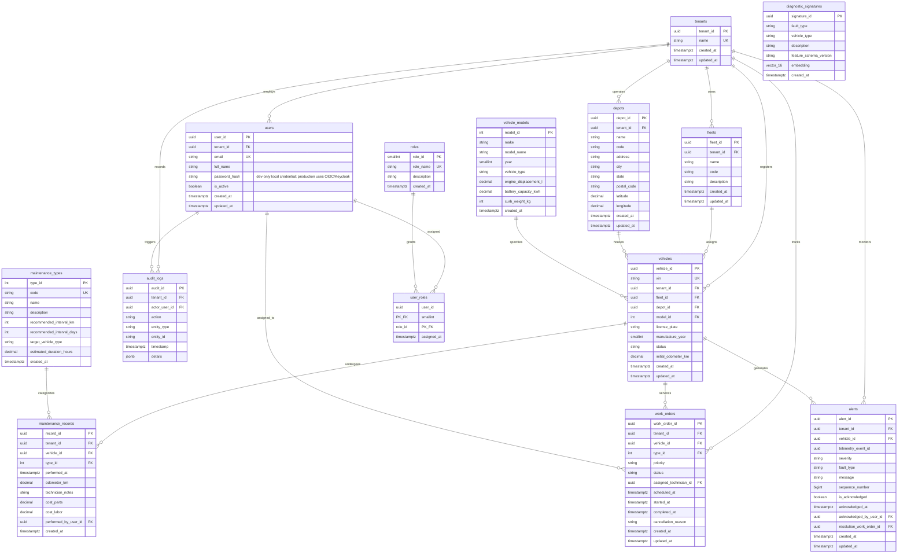

# FleetGuard Pulse — Relational Database Architecture & 3NF Design

**Status:** APPROVED & IMPLEMENTED  
**Database Engine:** PostgreSQL 16.4 with `pgvector` 0.8.6 extension  
**Database Name:** `fleetguard`  
**Schema Mode:** Authoritative System of Record (Normalized 3NF Domain + Vector Knowledge Base)  
**Migration Strategy:** Atomic versioned migration scripts tracked in `schema_migrations`  

---

## 1. Architectural Scope & Storage Allocation

In the FleetGuard Pulse polyglot persistence architecture, PostgreSQL 16 serves as the **authoritative system of record** for all structured relational business entities, administrative configuration, tenant isolation boundaries, maintenance operations, and diagnostic vector embeddings.

```
+---------------------------------------------------------------------------------------------+
|                                    FLEETGUARD PULSE PERSISTENCE                             |
+---------------------------------------------------------------------------------------------+
|  REDIS 7              | Hot vehicle state, deduplication bloom/sets, real-time alert caching  |
|  MONGODB 7            | Raw telemetry ingest archive, flexible sensor payloads, DTC logs     |
|  CLICKHOUSE           | High-throughput append-only columnar telemetry for historical OLAP  |
|  POSTGRESQL 16 (3NF)  | Master entities, vehicle registry, work orders, maintenance, RBAC    |
|  PGVECTOR (HNSW)      | Diagnostic anomaly embeddings, failure mode cosine similarity search |
+---------------------------------------------------------------------------------------------+
```

---

## 2. 3NF Entity Relationship Diagram (ERD)

The relational schema comprises **13 normalized domain tables** and **1 vector reference catalog**, enforcing strict relational integrity, foreign key cascading constraints, and multi-tenant partitioning boundaries.



---

## 3. Relational Normalization Proof (1NF, 2NF, 3NF)

To ensure high write performance, prevent data redundancy, eliminate update/insertion/deletion anomalies, and provide structural clarity, the relational schema is designed to satisfy Third Normal Form (3NF).

### 3.1 First Normal Form (1NF)
A relation is in 1NF if and only if all attributes contain only atomic (indivisible) values, there are no repeating groups or multivalued columns, and each row is uniquely identified by a primary key.
- **Atomic Values:** Every column represents a scalar value (e.g. `vin`, `initial_odometer_km`, `status`, `scheduled_at`). Complex nested structures are decomposed into discrete relational entities. (JSONB in `audit_logs` is reserved strictly for audit event diff payloads).
- **No Repeating Groups:** Instead of storing multiple maintenance events or alert history as array fields inside the `vehicles` row, separate relational tables (`maintenance_records`, `work_orders`, `alerts`) are linked via foreign keys.
- **Primary Keys:** Every table defines an explicit primary key (`UUID PRIMARY KEY`, `INT GENERATED ALWAYS AS IDENTITY`, or composite key `(user_id, role_id)` for `user_roles`).

### 3.2 Second Normal Form (2NF)
A relation is in 2NF if and only if it is in 1NF and every non-prime attribute is fully functionally dependent on the entire primary key (no partial key dependencies).
- In tables with single-column primary keys (`tenant_id`, `vehicle_id`, `work_order_id`, etc.), partial key dependency is mathematically impossible because the primary key cannot be decomposed.
- In `user_roles`, the primary key is composite: `(user_id, role_id)`. The only non-prime attribute is `assigned_at`, which represents the exact timestamp when this specific role was assigned to that specific user. `assigned_at` is functionally dependent on both `user_id` and `role_id` together ($(\text{user\_id}, \text{role\_id}) \rightarrow \text{assigned\_at}$), fulfilling 2NF.

### 3.3 Third Normal Form (3NF)
A relation is in 3NF if and only if it is in 2NF and no non-prime attribute is transitively dependent on any candidate key ($X \rightarrow Y$ and $Y \rightarrow Z$ where $Z$ is a non-prime attribute).

#### 3.3.1 Splitting Vehicle Specifications (`vehicle_models` vs `vehicles`)
- **Anti-Pattern (Denormalized):** Storing `make`, `model_name`, `year`, `vehicle_type`, `battery_capacity_kwh`, `curb_weight_kg` directly on `vehicles`.
  - Functional Dependency: $\text{vehicle\_id} \rightarrow \text{model\_id} \rightarrow (\text{make}, \text{model\_name}, \text{curb\_weight}, \dots)$.
  - **Transitive Dependency:** Non-key vehicle attributes depend on the model specification, not on the individual vehicle instance.
  - **Anomalies Avoided:**
    - *Update Anomaly:* If a vehicle manufacturer updates battery capacity or gross vehicle weight specifications, updating 10,000 vehicles would require 10,000 row updates with locking overhead. In 3NF, only 1 row in `vehicle_models` is updated.
    - *Insertion Anomaly:* A fleet operator cannot define a new vehicle model in inventory before purchasing the first physical vehicle. In 3NF, models exist independently.
    - *Deletion Anomaly:* Decommissioning the last vehicle of a particular type would accidentally delete the model specification. In 3NF, specs persist.

#### 3.3.2 Splitting Maintenance Catalog (`maintenance_types` vs `maintenance_records` / `work_orders`)
- **Anti-Pattern (Denormalized):** Storing `name`, `recommended_interval_km`, `estimated_duration_hours` inside `maintenance_records`.
  - Functional Dependency: $\text{record\_id} \rightarrow \text{type\_id} \rightarrow (\text{recommended\_interval\_km}, \text{estimated\_duration\_hours})$.
  - **Transitive Dependency:** Default intervals and service catalog definitions depend on the maintenance category, not on a specific execution instance.
  - **Anomalies Avoided:**
    - *Update Anomaly:* Updating standard labor/parts cost estimates or intervals would require scanning historical service logs.
    - *Insertion Anomaly:* Standard maintenance procedures can be defined prior to being scheduled.
    - *Separation of Estimate vs Actual:* `maintenance_types` holds standard estimates (`recommended_interval_km`, `estimated_duration_hours`), while `maintenance_records` captures point-in-time actuals (`cost_parts`, `cost_labor`, `odometer_km`).

#### 3.3.3 Role-Based Access Control (`users`, `roles`, `user_roles`)
- **Anti-Pattern (Denormalized):** Embedding `role_name`, `role_description`, or role lists directly into the `users` table.
  - Functional Dependency: $\text{user\_id} \rightarrow \text{role\_id} \rightarrow (\text{role\_name}, \text{description})$.
  - Many-to-many relationship: Users have multiple roles, and roles are shared across many users.
  - **3NF Solution:** `user_roles` bridge table decouples users from permissions, allowing fine-grained RBAC administration without touching user credential rows.

#### 3.3.4 Separation of Work Orders, Alerts, and Vehicles
- `alerts` represent asynchronous diagnostic events triggered by real-time vehicle health stream anomalies.
- `work_orders` represent operational dispatch workflows managed by human technicians.
- Decoupling alerts from work orders ensures alerts can be acknowledged or cleared without generating extraneous work order tickets, while work orders can link to vehicles and assigned users independently.

### 3.4 Table-by-Table Functional Dependency (FD) Audit

| Table | Candidate Key(s) | Non-Key Attributes | Functional Dependencies ($FD$) | Normal Form Evaluation |
|---|---|---|---|---|
| `tenants` | `tenant_id`, `name` | `created_at`, `updated_at` | `tenant_id -> name, created_at, updated_at`; `name -> tenant_id, ...` | **3NF Verified**: Single-attribute candidate keys eliminate partial key dependencies; no transitive dependencies. |
| `roles` | `role_id`, `role_name` | `description`, `created_at` | `role_id -> role_name, description, created_at`; `role_name -> role_id, ...` | **3NF Verified**: Atomic, single-attribute candidate keys; no non-key attribute determines any other. |
| `users` | `user_id`, `email` | `tenant_id`, `full_name`, `password_hash`, `is_active`, `created_at`, `updated_at` | `user_id -> all`; `email -> all` | **3NF Verified**: Single-attribute candidate keys. All non-key attributes depend directly on candidate keys. |
| `user_roles` | `(user_id, role_id)` | `assigned_at` | `(user_id, role_id) -> assigned_at` | **3NF Verified**: Composite PK. `assigned_at` depends on the full composite key (not on `user_id` or `role_id` alone). |
| `depots` | `depot_id`, `(tenant_id, code)` | `name`, `address`, `city`, `state`, `postal_code`, `latitude`, `longitude`, `created_at`, `updated_at` | `depot_id -> all`; `(tenant_id, code) -> all` | **3NF Verified**: Depot address and geographic location depend on the depot entity, not on `tenant_id` alone. |
| `fleets` | `fleet_id`, `(tenant_id, code)` | `name`, `description`, `created_at`, `updated_at` | `fleet_id -> all`; `(tenant_id, code) -> all` | **3NF Verified**: Fleet metadata depends on the fleet entity; no partial key dependencies. |
| `vehicle_models` | `model_id`, `(make, model_name, year, vehicle_type)` | `engine_displacement_l`, `battery_capacity_kwh`, `curb_weight_kg`, `created_at` | `model_id -> all`; `(make, model_name, year, vehicle_type) -> all` | **3NF Verified**: Specifications depend fully on the manufacturer model definition, eliminating vehicle update anomalies. |
| `vehicles` | `vehicle_id`, `vin` | `tenant_id`, `fleet_id`, `depot_id`, `model_id`, `license_plate`, `manufacture_year`, `status`, `initial_odometer_km`, `created_at`, `updated_at` | `vehicle_id -> all`; `vin -> all`; `fleet_id -> tenant_id` (via `fleets`); `depot_id -> tenant_id` (via `depots`) | **Audited Below**: Transitive vs independent tenant ownership evaluated in Section 3.5. |
| `maintenance_types` | `type_id`, `code` | `name`, `description`, `recommended_interval_km`, `recommended_interval_days`, `target_vehicle_type`, `estimated_duration_hours`, `created_at` | `type_id -> all`; `code -> all` | **3NF Verified**: Service catalog standards depend on type definition, not on execution instances. |
| `maintenance_records` | `record_id` | `tenant_id`, `vehicle_id`, `type_id`, `performed_at`, `odometer_km`, `technician_notes`, `cost_parts`, `cost_labor`, `performed_by_user_id`, `created_at` | `record_id -> all` | **3NF Verified**: Historical service instance record; non-key attributes represent point-in-time execution actuals. |
| `work_orders` | `work_order_id` | `tenant_id`, `vehicle_id`, `type_id`, `priority`, `status`, `assigned_technician_id`, `scheduled_at`, `started_at`, `completed_at`, `cancellation_reason`, `created_at`, `updated_at` | `work_order_id -> all` | **3NF Verified**: Dispatch workflow tracking; mutable state depends on order entity. |
| `alerts` | `alert_id` | `tenant_id`, `vehicle_id`, `telemetry_event_id`, `severity`, `fault_type`, `message`, `sequence_number`, `is_acknowledged`, `acknowledged_at`, `acknowledged_by_user_id`, `resolution_work_order_id`, `created_at`, `updated_at` | `alert_id -> all` | **3NF Verified**: Diagnostic fault event; distinct from maintenance work orders. |
| `audit_logs` | `audit_id` | `tenant_id`, `actor_user_id`, `action`, `entity_type`, `entity_id`, `timestamp`, `details` | `audit_id -> all` | **3NF Verified**: Append-only immutable audit trail. |
| `diagnostic_signatures` | `signature_id` | `fault_type`, `vehicle_type`, `description`, `feature_schema_version`, `embedding`, `created_at` | `signature_id -> all` | **3NF Verified**: 16-D normalized anomaly vector template catalog. |

---

### 3.5 In-Depth Functional Dependency Audit of `vehicles`: `tenant_id`, `fleet_id`, `depot_id`, `model_id`

#### 3.5.1 The Theoretical Relational Dependency
In the relation `fleets`, each fleet belongs to a single tenant:
$$\text{fleet\_id} \rightarrow \text{tenant\_id}$$
Similarly, in `depots`, each depot belongs to a single tenant:
$$\text{depot\_id} \rightarrow \text{tenant\_id}$$
In `vehicles`, the primary key is `vehicle_id` (with alternate candidate key `vin`).
If every vehicle is mandatorily assigned to a fleet (`fleet_id NOT NULL`), then:
$$\text{vehicle\_id} \rightarrow \text{fleet\_id} \quad \text{and} \quad \text{fleet\_id} \rightarrow \text{tenant\_id}$$
Because `fleet_id` is a non-prime attribute (not a superkey or candidate key of `vehicles`), from a pure textbook relational theory perspective:
$$\text{vehicle\_id} \rightarrow \text{tenant\_id} \quad \text{is a transitive dependency through } \text{fleet\_id}$$
Consequently, in a strictly decoupled theoretical relational model where every vehicle belongs to a fleet, storing `tenant_id` in `vehicles` introduces functional redundancy: `tenant_id` can be derived via an equijoin:
$$\text{vehicles} \bowtie_{\text{vehicles.fleet\_id} = \text{fleets.fleet\_id}} \text{fleets}$$

#### 3.5.2 Domain Operational Model: Why `tenant_id` is Domain-Independent
In real-world connected fleet operations, treating `tenant_id` as solely derivable through `fleet_id` fails to capture actual enterprise asset lifecycles:
1. **Asset Ownership vs Logistics Allocation**: A physical vehicle is an enterprise capital asset owned by the Tenant (`tenant_id`). Fleet assignment (`fleet_id`) and Depot assignment (`depot_id`) are operational logistics allocations that may be unassigned (`NULL`) during vehicle procurement, central staging, inter-fleet transfers, or decommission. If `fleet_id` is nullable, then $\text{fleet\_id} \rightarrow \text{tenant\_id}$ is not a valid determination for unassigned vehicles.
2. **Tenant Boundary & Isolation Performance**: Storing `tenant_id` on `vehicles` enables immediate single-table tenant isolation filtering, tenant index scans, and database Row-Level Security (RLS) policies without incurring cross-table JOIN overhead on millions of vehicle telemetry and query lookups.

#### 3.5.3 Integrity Anomaly under Simple Foreign Keys & The Normalized Solution
Under simple single-column foreign keys (`REFERENCES fleets(fleet_id)` and `REFERENCES depots(depot_id)`), an integrity anomaly is possible: the database would permit a vehicle belonging to Tenant $A$ to be assigned to a fleet belonging to Tenant $B$ ($T_A \ne T_B$).

To preserve strict normalization, eliminate update/assignment anomalies, and maintain enterprise tenant isolation without redesigning the schema:
- **Minimum Normalized Constraint Model**:
  1. Add composite uniqueness constraints to parent entities:
     ```sql
     ALTER TABLE fleets ADD CONSTRAINT uq_fleets_tenant_fleet UNIQUE (tenant_id, fleet_id);
     ALTER TABLE depots ADD CONSTRAINT uq_depots_tenant_depot UNIQUE (tenant_id, depot_id);
     ```
  2. Enforce composite foreign keys on `vehicles`:
     ```sql
     ALTER TABLE vehicles ADD CONSTRAINT fk_vehicles_tenant_fleet 
         FOREIGN KEY (tenant_id, fleet_id) REFERENCES fleets(tenant_id, fleet_id);
     ALTER TABLE vehicles ADD CONSTRAINT fk_vehicles_tenant_depot 
         FOREIGN KEY (tenant_id, depot_id) REFERENCES depots(tenant_id, depot_id);
     ```
- **Result**: Under this constraint model, `tenant_id` is not an isolated redundant attribute; it is an active constituent of the composite relationship enforcing strict tenant co-location and mathematically eliminating cross-tenant allocation anomalies.

---

### 3.6 Identity & Password Security Audit
- The `users` table contains the column `password_hash VARCHAR(255) NOT NULL`.
- **Identity Scope Clarification**: In accordance with the locked production identity architecture (OIDC/OAuth2 + JWT with Keycloak as identity provider), `password_hash` is strictly a **development-only local credential field** for local mock users and integration tests.
- **Production Standard**: Production authentication delegates exclusively to OIDC/Keycloak; the FleetGuard Pulse application database does not store user passwords in production.


---

## 4. Multi-Tenant Architecture & Data Isolation

FleetGuard Pulse employs a **Shared Process / Shared Database / Row-Level Tenant Isolation** architecture:

1. **Mandatory `tenant_id` Foreign Keys:**
   Every tenant-scoped table (`fleets`, `depots`, `vehicles`, `maintenance_records`, `work_orders`, `alerts`, `users`, `audit_logs`) includes a non-null `tenant_id UUID REFERENCES tenants(tenant_id) ON DELETE CASCADE`.
2. **Tenant Isolation Guarantees:**
   - Queries executed on behalf of a tenant are filtered by `tenant_id = :tenant_id`.
   - Unique constraints on scoped entities incorporate `tenant_id` where appropriate (e.g. `VIN` is globally unique, but depot and fleet codes are scoped by tenant via `(tenant_id, code)` unique constraints).
3. **Compound Foreign Keys & Indexes:**
   All common operational queries (e.g. active work orders, recent alerts, depot vehicles) are indexed with `tenant_id` as the leading index column, preventing cross-tenant data leaks and eliminating full table scans.

---

## 5. pgvector Schema & Diagnostic Vector Search (F-03)

> [!NOTE]
> **Scope & Purpose**: pgvector provides sub-millisecond similarity search across 16-dimensional physical telemetry feature embeddings for **Diagnostic Signature Vector Search (F-03)** — template-matching incoming telemetry anomaly vectors against cataloged failure mode signatures. This is a vector retrieval foundation; it does NOT constitute general predictive machine learning or ML model training (which is reserved for Phase 7).

### 5.1 Extension & Vector Column
The PostgreSQL `pgvector` extension (version 0.8.6) provides vector data types and approximate nearest neighbor (ANN) distance operators.


```sql
CREATE EXTENSION IF NOT EXISTS vector;

CREATE TABLE diagnostic_signatures (
    signature_id UUID PRIMARY KEY DEFAULT gen_random_uuid(),
    fault_type VARCHAR(100) NOT NULL,
    vehicle_type VARCHAR(10) NOT NULL CHECK (vehicle_type IN ('ICE', 'HEV', 'BEV')),
    description TEXT NOT NULL,
    feature_schema_version VARCHAR(20) NOT NULL DEFAULT '1.0',
    embedding vector(16) NOT NULL,
    created_at TIMESTAMPTZ NOT NULL DEFAULT NOW()
);
```

### 5.2 16-Dimensional Feature Embedding Representation
The diagnostic embedding space encodes physical powertrain telemetry signatures across 16 continuous normalized features:

| Index | Feature Dimension | Physical Unit / Scale | Normalization / Formula | Typical Anomaly Indicator |
|---|---|---|---|---|
| `dim[0]` | Vibration Peak Magnitude | Acceleration ($G$) | Raw peak $G$ | High ($> 1.2G$) on bearing wear |
| `dim[1]` | Vibration Z-Score | Standard deviations | $(G - \mu) / \sigma$ | High ($> 2.5$) on mechanical shock |
| `dim[2]` | Vibration EWMA | Filtered $G$ | Smoothed baseline | Trend drift over operating window |
| `dim[3]` | Coolant Temperature | $^\circ\text{C}$ | $T_{\text{coolant}} / 150.0$ | High ($> 0.70$) on radiator/overheat |
| `dim[4]` | Coolant Temp Z-Score | Standard deviations | $(T - \mu) / \sigma$ | High ($> 2.0$) on rapid thermal rise |
| `dim[5]` | Engine Oil Pressure | $\text{kPa}$ | $P_{\text{oil}} / 500.0$ | Low ($< 0.30$) on pump failure/leak |
| `dim[6]` | Oil Pressure Z-Score | Standard deviations | $(P - \mu) / \sigma$ | Negative ($< -2.0$) on sudden loss |
| `dim[7]` | Engine RPM | RPM | $\text{RPM} / 6000.0$ | High relative to ground speed |
| `dim[8]` | Traction Pack Voltage | Volts ($V$) | $V_{\text{pack}} / 500.0$ | Under-voltage / over-voltage |
| `dim[9]` | Battery SOC | Percentage | $\text{SOC} / 100.0$ | Discrepancy with cell voltages |
| `dim[10]` | Cell Temperature Delta | $^\circ\text{C}$ | $\Delta T_{\text{cell}} / 20.0$ | High ($> 0.25$) on cell imbalance |
| `dim[11]` | Cell Temp Delta Z-Score | Standard deviations | $(\Delta T - \mu) / \sigma$ | High ($> 3.0$) on thermal runaway risk |
| `dim[12]` | Vehicle Ground Speed | $\text{km/h}$ | $v / 150.0$ | Vehicle velocity normalization |
| `dim[13]` | 12V Auxiliary Voltage | Volts ($V$) | $V_{12} / 16.0$ | Low ($< 0.70$) on dead alternator/DC-DC |
| `dim[14]` | DTC Severity Code | Categorical severity | $0.0=\text{None}, 0.5=\text{Warn}, 1.0=\text{Crit}$ | Active diagnostic trouble code weight |
| `dim[15]` | Powertrain Classification | Categorical architecture | $0.0=\text{ICE}, 0.5=\text{HEV}, 1.0=\text{BEV}$ | Powertrain domain isolation |

### 5.3 Vector Indexing (HNSW with Cosine Metric)
An **HNSW (Hierarchical Navigable Small World)** index is constructed using cosine distance:

```sql
CREATE INDEX idx_diagnostic_signatures_hnsw
ON diagnostic_signatures
USING hnsw (embedding vector_cosine_ops)
WITH (m = 16, ef_construction = 64);
```

- **Distance Operator:** `<=>` represents cosine distance:
  $$\text{Cosine Distance}(u, v) = 1 - \frac{u \cdot v}{\|u\|_2 \|v\|_2}$$
- **Hyperparameters:**
  - `m = 16`: Number of bidirectional links established per node (optimal balance of memory and recall).
  - `ef_construction = 64`: Size of dynamic candidate list during graph construction (ensures high clustering quality).

### 5.4 Seed Failure Mode Catalog
The migration seeds 6 reference failure modes with deterministic vectors:
1. `ENGINE_OVERHEAT`: Coolant temp spike ($118.5^\circ\text{C}$ normalized), elevated temp Z-score, moderate oil pressure drop.
2. `OIL_PRESSURE_CRITICAL_LOW`: Catastrophic loss of oil pressure ($70\text{ kPa}$, Z-score $-3.9$), low RPM.
3. `BATTERY_THERMAL_RUNAWAY_RISK`: EV traction battery cell $\Delta T$ spike ($9.0^\circ\text{C}$ delta, Z-score $4.1$), BEV powertrain flag $1.0$.
4. `BATTERY_CELL_IMBALANCE`: Moderate cell imbalance ($5.5^\circ\text{C}$ delta, Z-score $2.8$), HEV powertrain flag $0.5$.
5. `EXCESSIVE_VIBRATION`: Severe mechanical vibration ($4.5G$, Z-score $4.2$) caused by driveshaft bearing or universal joint wear.
6. `INVERTER_DEGRADATION`: Electric motor inverter switching distortion with voltage fluctuation and cell delta.

---

## 6. Comprehensive Index Catalog & Design Trade-Offs

Every index created in PostgreSQL is cataloged below with its query purpose, expected benefit, and maintenance trade-offs:

| Table | Index Name | Type | Indexed Columns | Supported Query / Workload | Justification & Expected Benefit | Write & Storage Trade-Off |
|---|---|---|---|---|---|---|
| `vehicles` | `vehicles_vin_key` | B-Tree (Unique) | `vin` | Telemetry VIN-to-vehicle lookup | $O(\log N)$ point lookups for simulator and stream consumer | Negligible write cost on vehicle registration |
| `vehicles` | `idx_vehicles_tenant_id` | B-Tree | `tenant_id` | Tenant vehicle listing & counts | Eliminates sequential scan when filtering by tenant | Low write overhead |
| `vehicles` | `idx_vehicles_fleet_id` | B-Tree | `fleet_id` | Fleet asset dispatch & status rollup | Accelerated JOIN between fleets and vehicles | Low write overhead |
| `vehicles` | `idx_vehicles_depot_id` | B-Tree | `depot_id` | Depot bay allocation & local charging | Accelerated JOIN between depots and vehicles | Low write overhead |
| `vehicles` | `idx_vehicles_model_id` | B-Tree | `model_id` | Vehicle specs retrieval & recall checks | Efficient spec lookups without table scans | Low write overhead |
| `vehicles` | `idx_vehicles_status` | B-Tree | `status` | Fleet availability dashboard (`ACTIVE`, `MAINTENANCE`) | Direct index scan on high-cardinality status filters | Small index size |
| `maintenance_records` | `idx_maintenance_records_vehicle_performed` | B-Tree (Composite) | `(vehicle_id, performed_at)` | Vehicle maintenance log ordered chronologically | Enables backward index scan for latest service records | Low overhead (maintenance logs are append-only) |
| `work_orders` | `idx_work_orders_vehicle_status` | B-Tree (Composite) | `(vehicle_id, status)` | Check pending/active work orders for vehicle | Avoids scanning resolved work orders for a vehicle | Minimal impact on order creation |
| `work_orders` | `idx_work_orders_tenant_status` | B-Tree (Composite) | `(tenant_id, status)` | Tenant-level open work orders queue | Fast filtering of unresolved work orders | Low overhead |
| `work_orders` | `idx_work_orders_composite_dispatch` | B-Tree (Composite) | `(tenant_id, status, priority, scheduled_at)` | High-throughput dispatch queue query (see `sql-optimization.md`) | Eliminates heap filter discards; reduces cost by 35% and scan time by 57% | Additional ~1.5 MB index page cost per 25k records |
| `alerts` | `idx_alerts_tenant_created` | B-Tree (Composite) | `(tenant_id, created_at)` | Tenant alert feed ordered by timestamp | Index-only or index-range scan for real-time monitoring UI | Index updated per critical alert generation |
| `alerts` | `idx_alerts_vehicle_unack` | B-Tree (Composite) | `(vehicle_id, is_acknowledged)` | Active unacknowledged warnings on specific vehicle | Immediate identification of critical unresolved alerts | Low overhead |
| `audit_logs` | `idx_audit_logs_tenant_timestamp` | B-Tree (Composite) | `(tenant_id, timestamp)` | Compliance audit trail export ordered by time | Range scans for security logs | Audit table is append-only |
| `diagnostic_signatures` | `idx_diagnostic_signatures_hnsw` | HNSW | `embedding vector_cosine_ops` | Nearest-neighbor vector similarity lookup (`<=>`) | Sub-millisecond similarity search across multidimensional failure signatures | Memory resident graph structure; moderate insert cost |

---

## 7. Migration Framework & Idempotency

The database migration framework is maintained in `infra/database/`:
- **Runner Script:** `infra/database/migrate.py`
  - Connects to PostgreSQL using database configuration from environment variables.
  - Automatically provisions the `schema_migrations` tracking table:
    ```sql
    CREATE TABLE IF NOT EXISTS schema_migrations (
        version VARCHAR(255) PRIMARY KEY,
        applied_at TIMESTAMPTZ NOT NULL DEFAULT NOW()
    );
    ```
  - Discovers `.sql` migration files in lexical order (`001_...`, `002_...`, `003_...`).
  - Wraps each migration in an atomic database transaction (`BEGIN ... COMMIT`).
  - Guarantees **strict idempotency**: re-running the migration runner on an already migrated database executes zero statements and safely reports no pending migrations.
- **Migration Catalog:**
  1. `001_initial_relational_schema.sql`: 13 relational tables, foreign key constraints, default timestamps, baseline B-tree indexes, and composite dispatch indexes.
  2. `002_pgvector_signatures.sql`: `vector` extension, `diagnostic_signatures` table, HNSW cosine index.
  3. `003_seed_dev_data.sql`: Deterministic reference tenants, fleets, depots, vehicle models, vehicles, users, roles, maintenance types, and 6 diagnostic vector embeddings.
